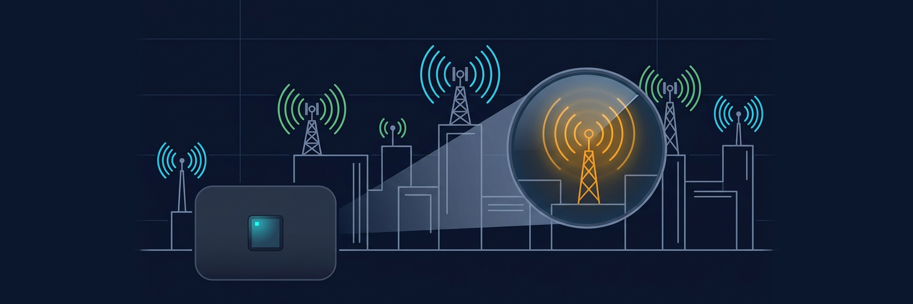
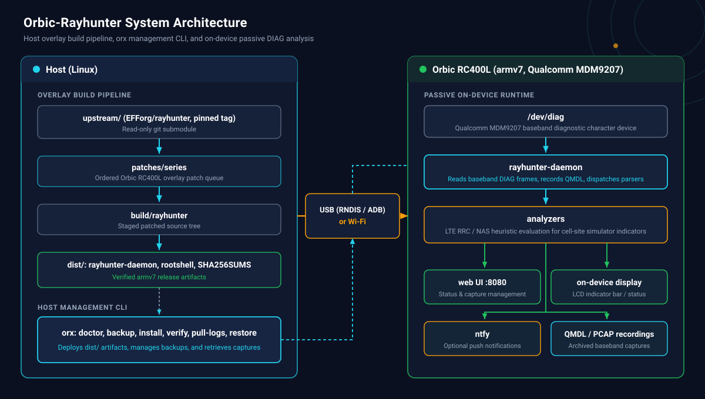
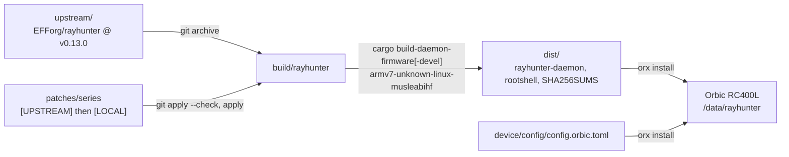
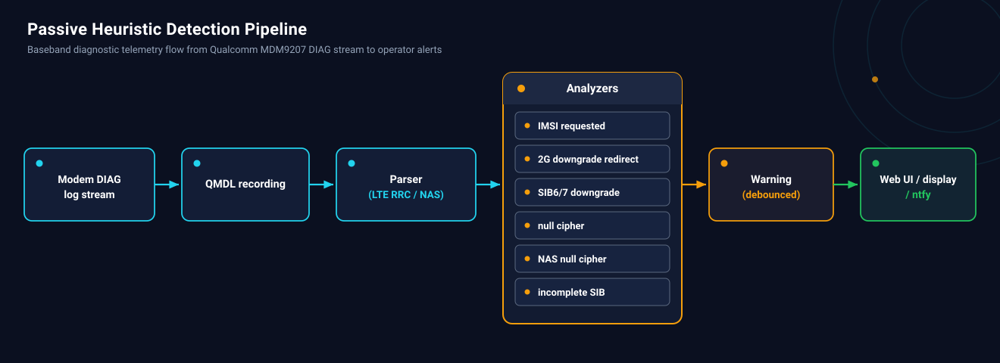
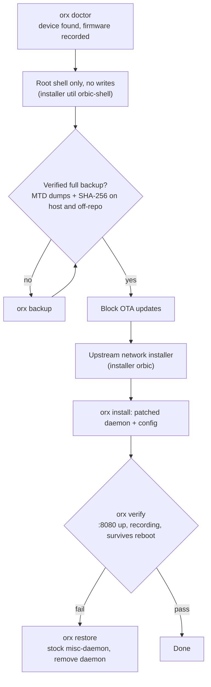
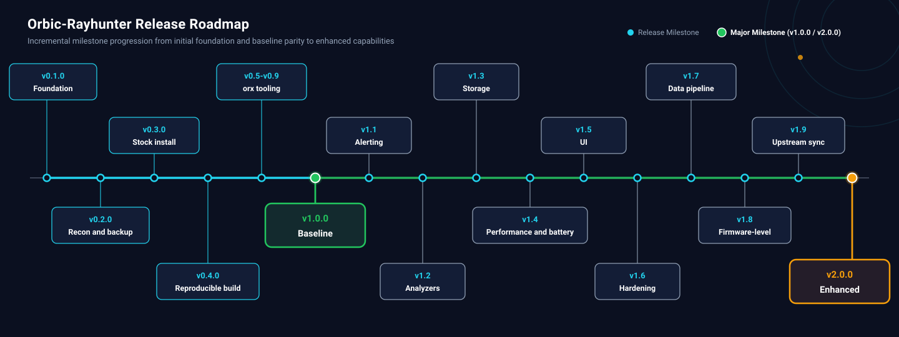

<p align="center">
  
</p>

<h1 align="center">Orbic-Rayhunter</h1>

<p align="center">
  
</p>

<p align="center">
<a href="https://github.com/doublegate/Orbic-Rayhunter/actions/workflows/ci.yml"></a> <a href="https://github.com/doublegate/Orbic-Rayhunter/actions/workflows/docs.yml"></a> <a href="https://github.com/doublegate/Orbic-Rayhunter/actions/workflows/security.yml"></a> <a href="rust-toolchain.toml"></a> <a href="Cargo.toml"></a><br/>
<a href="#support-matrix"></a> <a href="docs/BUILD.md"></a> <a href="https://github.com/EFForg/rayhunter/releases/tag/v0.13.0"></a><br/>
<a href="LICENSE"></a> <a href="#scope-and-legal"></a> <a href="PROJECT-STATUS.md"></a>
</p>

Install, harden and extend [EFF Rayhunter](https://github.com/EFForg/rayhunter), a passive
IMSI-catcher / cell-site-simulator detector, on the **Orbic Speed RC400L** LTE hotspot.

This repository is an overlay on upstream Rayhunter, not a fork: upstream is pinned as a git
submodule, and this project adds a patch series, host tooling, device configuration, reverse
engineering notes and documentation on top. Generic improvements are written to be submitted
back to EFForg/rayhunter.

> Status: **v0.6.0 (Phase 4: `orx doctor` v2, device transport, and `orx backup` -- validated
> on the unit).** Next: `orx verify`/`pull-logs`/`install`/`uninstall`, then the v1.0.0 install. Use the upstream release and the
> [official Orbic guide](https://efforg.github.io/rayhunter/orbic.html) until v1.0.0. Current
> state: [PROJECT-STATUS.md](PROJECT-STATUS.md).

## Support matrix

| Device | Firmware | Upstream pin | Status |
|---|---|---|---|
| Orbic Speed RC400L (Verizon), Qualcomm MDM9207 | `ORB400L_V1.2.0_BVZRT` | v0.13.0 | in development |

Other firmware builds and other Rayhunter-supported devices are out of scope until v1.0.0.

## What the research established

Findings from the Phase 0 research pass ([ref-docs/](ref-docs/)) that shape every later phase:

- **There is no software unbrick path.** EDL (`05c6:9008`) is reachable only through a hardware
  test point under the LCD, and no working firehose loader is confirmed for this device. A
  verified, checksummed MTD backup taken before the first write is the only recovery asset, so
  it is a hard gate ([docs/BACKUP-AND-RECOVERY.md](docs/BACKUP-AND-RECOVERY.md)).
- **Upstream's default installer is network-based.** `installer orbic` logs in to the stock web
  admin and gains a root shell through a command injection in `SetRemoteAccessCfg`;
  `installer orbic-usb` (vendor USB request, ADB) is a fallback that has bricked units. No public
  report covers the current installer on `V1.2.0` specifically.
- **Upstream replaces the stock `/etc/init.d/misc-daemon`** for persistence and its uninstall is
  manual and incomplete; disk-full conditions have wedged the hotspot. Both are addressed by
  `orx backup` / `orx restore` and retention work in v0.5 to v0.9.
- **Verizon ships firmware up to `V1.3.2`.** OTA updates are blocked until their effect on the
  install path is measured.
- **Detection gaps exist upstream.** A 2026 study of a commercial fake base station (Devilray)
  shows IMSI catching via NAS Reject goes unflagged; null integrity (EIA0), authentication
  failure/reject and IMSI paging are not checked; measurement data never reaches analyzers.
  These drive the v1.2 analyzer work ([docs/ANALYZERS.md](docs/ANALYZERS.md)).
- **Captures may include user traffic.** Upstream subscribes to DIAG log code `0x11EB` (user IP
  traffic). Whether that reaches QMDL is checked on-device in Phase 1 before any capture is shared.

## Quick start (development)

```sh
git clone --recurse-submodules https://github.com/doublegate/Orbic-Rayhunter
cd Orbic-Rayhunter
cargo run -p orx-cli -- doctor     # detect the Orbic over USB, probe its web UIs
scripts/apply-patches.sh           # stage upstream + patches/ in build/rayhunter
scripts/build.sh devel             # armv7 musl daemon + rootshell into dist/
```

Building details: [docs/BUILD.md](docs/BUILD.md). Installation (from v1.0.0):
[docs/INSTALL.md](docs/INSTALL.md). Take a full backup first:
[docs/BACKUP-AND-RECOVERY.md](docs/BACKUP-AND-RECOVERY.md).

## Architecture

`upstream/` (Rayhunter, pinned tag) + `patches/` (ordered series, each tagged `[UPSTREAM]` or
`[LOCAL]`) is staged into `build/rayhunter` and cross-compiled for `armv7-unknown-linux-musleabihf`
with upstream's own toolchain and build profiles. `crates/orx-cli` is the host tool (`orx`):
device detection now, then backup, install, verify and log retrieval. `device/` holds on-device
configuration, `re/` holds reverse-engineering notes (never firmware blobs). See
[docs/ARCHITECTURE.md](docs/ARCHITECTURE.md).

<p align="center">
  <picture>
    <source media="(prefers-color-scheme: dark)" srcset="docs/images/architecture-dark.svg">
    <source media="(prefers-color-scheme: light)" srcset="docs/images/architecture-light.svg">
    
  </picture>
</p>

### Build pipeline



### Detection pipeline

<p align="center">
  
</p>

The analyzers shown are upstream's default heuristics; planned additions (NAS reject, authentication
failure, EIA0, IMSI paging and others) are tracked in [docs/ANALYZERS.md](docs/ANALYZERS.md).

### Install safety gate



## Roadmap

<p align="center">
  
</p>

Details, ticket IDs and exit criteria: [ROADMAP.md](ROADMAP.md).

## Repository layout

| Path | Contents |
|---|---|
| `upstream/` | EFForg/rayhunter submodule, pinned to `v0.13.0`; never edited |
| `patches/` | `series` plus `NNNN-*.patch` files tagged `[UPSTREAM]` or `[LOCAL]` |
| `crates/orx-cli/` | the `orx` host tool |
| `scripts/` | `apply-patches.sh`, `build.sh`, `sync-upstream.sh`, `gen-assets.sh` |
| `device/` | on-device configuration (`config/config.orbic.toml`) |
| `re/` | reverse-engineering notes (no firmware binaries) |
| `backups/` | local-only device backups (gitignored) |
| `assets/`, `docs/images/` | artwork, icons and diagrams |
| `docs/`, `ref-docs/`, `to-dos/` | specification, research corpus, phase plans |

## Documentation

| Topic | Document |
|---|---|
| Current state, risks, next steps | [PROJECT-STATUS.md](PROJECT-STATUS.md) |
| Releases v0.1.0 to v2.0.0, tickets T-OR-001 to T-OR-105 | [ROADMAP.md](ROADMAP.md) |
| Architecture and decisions | [docs/ARCHITECTURE.md](docs/ARCHITECTURE.md), [docs/adr/](docs/adr/) |
| Device facts (measured vs TBD) | [docs/DEVICE-PROFILE.md](docs/DEVICE-PROFILE.md) |
| Backup, recovery, install | [docs/BACKUP-AND-RECOVERY.md](docs/BACKUP-AND-RECOVERY.md), [docs/INSTALL.md](docs/INSTALL.md) |
| Configuration and analyzers | [docs/CONFIGURATION.md](docs/CONFIGURATION.md), [docs/ANALYZERS.md](docs/ANALYZERS.md) |
| Build, patches, CI, testing, performance | [docs/BUILD.md](docs/BUILD.md), [docs/PATCH-POLICY.md](docs/PATCH-POLICY.md), [docs/CI.md](docs/CI.md), [docs/TESTING.md](docs/TESTING.md), [docs/PERFORMANCE.md](docs/PERFORMANCE.md) |
| Security model, RE method, releases | [docs/SECURITY-MODEL.md](docs/SECURITY-MODEL.md), [docs/RE-METHODOLOGY.md](docs/RE-METHODOLOGY.md), [docs/RELEASE-PROCESS.md](docs/RELEASE-PROCESS.md) |
| Research corpus | [ref-docs/](ref-docs/) (upstream, install, hardware, firmware, DIAG/QMDL, detection literature, legal) |
| Phase and sprint plans | [to-dos/](to-dos/) |

## Scope and legal

Rayhunter is receive-only: it reads the hotspot's own modem diagnostics and never transmits on
licensed spectrum. Captures can contain identifiers (IMSI, IMEI); treat them as personal data.
See [ref-docs/legal-and-ethics.md](ref-docs/legal-and-ethics.md). This is not legal advice.

Modifying the device can brick it. This project's procedures require a verified full backup
before any write.

## License

GPL-3.0-or-later, matching upstream Rayhunter (GPL-3.0). See [LICENSE](LICENSE). Rayhunter is a
project of the Electronic Frontier Foundation; this project is independent and not affiliated
with or endorsed by EFF or Orbic.
